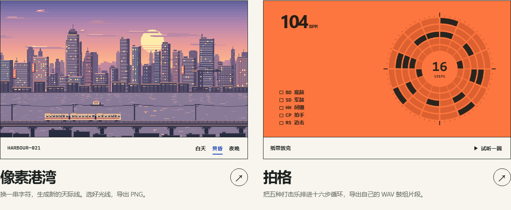

# Pocket Lab · 口袋实验室

给一座港口起名字，看它入夜。再为它编一段鼓点。两个小实验都在浏览器里运行，做完的图和声音可以直接带走。

**[打开口袋实验室 ↗](https://kunzi4261-lang.github.io/pocket-lab/)**

[](https://kunzi4261-lang.github.io/pocket-lab/)

## 像素港湾 · Pixel Harbor

把一段文字当作城市的种子，再选白天、黄昏或夜晚。相同的种子和时段会生成同一幅画。你可以导出 PNG，也可以把这座港口的链接发给别人。[看一眼黄昏的港湾](https://kunzi4261-lang.github.io/pocket-lab/city/?seed=HARBOUR-021&mood=dusk) · [生成器源码](city/)

## 拍格 · Beat Press

在 16 步网格里打开底鼓和军鼓，再试着加入不同的打击乐。边听边改速度，把满意的一小节导出为 WAV；分享链接会保留你的鼓谱和速度。[打开节奏机](https://kunzi4261-lang.github.io/pocket-lab/beat/) · [节奏机源码](beat/)

## 在本地玩

克隆仓库后，在根目录启动一个静态服务器：

```sh
python -m http.server 8000
```

在浏览器打开 `http://localhost:8000`。声音需要先点击播放。

使用 Node.js 24 运行自动化测试：

```sh
node --test
```

主分支在测试通过后自动发布到 GitHub Pages。[测试用例](tests/) · [部署记录](https://github.com/kunzi4261-lang/pocket-lab/actions/workflows/pages.yml)
